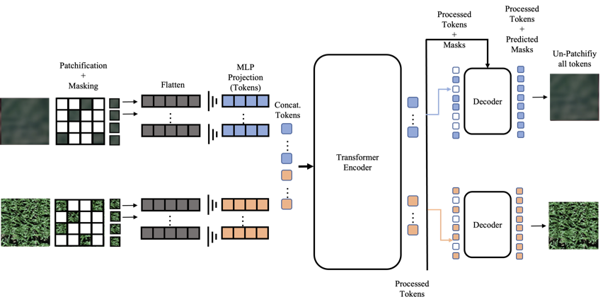

# Cross-Modal Learning for Crop Canopy Trait Estimation

[`arXiv`](https://arxiv.org/abs/2511.16031) | [`BibTeX`](#citation)

Official implementation for **Cross-Modal Learning for Crop Canopy Trait Estimation**.

<p align="center">

</p>


## Set-up

### Dependencies

This codebase has been tested with the packages and versions specified in `requirements.txt` and Python 3.8.

We recommend creating a new [conda](https://docs.conda.io/en/latest/) virtual environment:

```bash
conda create -n satuav python=3.8 -y
conda activate satuav
```

Then, install [PyTorch](https://pytorch.org/) 1.10.0+ and [torchvision](https://pytorch.org/vision/stable/index.html) 0.11.1+. For example:

```bash
conda install pytorch=1.10.0 torchvision=0.11.1 -c pytorch -y
```

Finally, install all other required packages:

```bash
pip install timm==0.4.12 einops==0.3.2 pandas==1.3.4 albumentations==1.1.0 wandb==0.12.11
```

Alternatively, install everything from the pinned requirements file:

```bash
pip install -r requirements.txt
```


### Dataset preparation

All datasets are structured so that each modality lives in its own folder and filenames match across modalities:

```
/path/to/data/
├── train/
│   ├── Sat_RGB/
│   │   └── location1/
│   │       ├── plot1.PNG
│   │       └── plot2.PNG
│   └── UAV_RGB/
│       └── location1/
│           ├── plot1.PNG
│           └── plot2.PNG
└── val/
    ├── Sat_RGB/
    │   └── location2/
    │       ├── plot3.PNG
    │       └── plot4.PNG
    └── UAV_RGB/
        └── location2/
            ├── plot3.PNG
            └── plot4.PNG
```

The folder structure and filenames should match across the `Sat_RGB` and `UAV_RGB` modalities so that each satellite image is paired with its co-registered UAV image. If a dataset does not have per-location subfolders, a generic subfolder name (e.g., `all/`) can be used instead. RGB images are stored as PNG or JPEG.

Refer to the [paper](https://www.cabidigitallibrary.org/doi/10.31220/agriRxiv.2024.00251) for data information.

## Training

All models are trained on a single node with **8 A100 GPUs**.

To train on 8 GPUs using the default settings, run:

```bash
OMP_NUM_THREADS=1 torchrun --nproc_per_node=8 run_pretraining_multimae.py \
--config cfgs/sat_uav.yaml \
--data_path /path/to/data/train
```

### Modifying configs

The training script supports both YAML config files and command-line arguments. See [`cfgs/sat_uav.yaml`](cfgs/sat_uav.yaml) for the default configuration, where the input and output modalities are set via:

```yaml
in_domains: Sat_RGB-UAV_RGB
out_domains: Sat_RGB-UAV_RGB
```

To modify training settings, either edit the config file or provide additional command-line arguments. For a full list of possible arguments, see [`run_pretraining_multimae.py`](run_pretraining_multimae.py).

:information_source: Config file arguments override default arguments, and command-line arguments override both default and config arguments.

:warning: When changing settings, make sure to update `output_dir` and `wandb_run_name` (if logging is activated) to reflect the changes.

### Experiment logging

To activate logging to [Weights & Biases](https://docs.wandb.ai/), either edit the config file or use the `--log_wandb` flag along with any other extra logging arguments.

## Acknowledgement

This repository is an adaptation of [MultiMAE: Multi-modal Multi-task Masked Autoencoders](https://github.com/EPFL-VILAB/MultiMAE/tree/main), which is itself built using the [timm](https://github.com/rwightman/pytorch-image-models/tree/master/timm), [DeiT](https://github.com/facebookresearch/deit), [DINO](https://github.com/facebookresearch/dino), [MoCo v3](https://github.com/facebookresearch/moco-v3), [BEiT](https://github.com/microsoft/unilm/tree/master/beit), [MAE-priv](https://github.com/BUPT-PRIV/MAE-priv), and [MAE](https://github.com/facebookresearch/mae) repositories.

## License

This project is under the CC-BY-NC 4.0 license. See [LICENSE](LICENSE) for details.

## Citation

If you find this repository helpful, please consider citing our work:

```BibTeX
@article{ayanlade2025crossmodal,
  title   = {Cross-Modal Learning for Crop Canopy Trait Estimation},
  author  = {Ayanlade, Timilehin T. and Powadi, Anirudha and Jubery, Talukder Z. and Ganapathysubramanian, Baskar and Sarkar, Soumik},
  journal = {arXiv preprint arXiv:2511.16031},
  year    = {2025},
}
```
